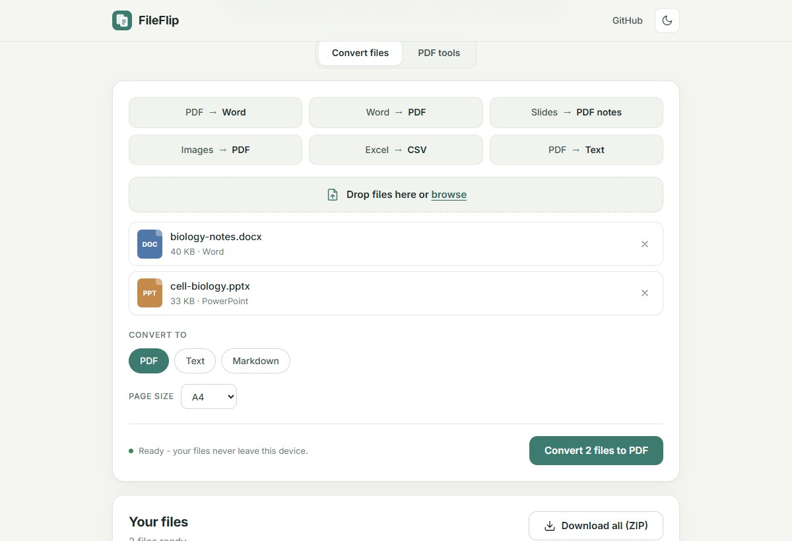
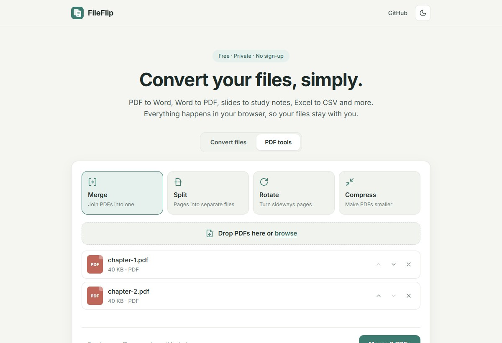
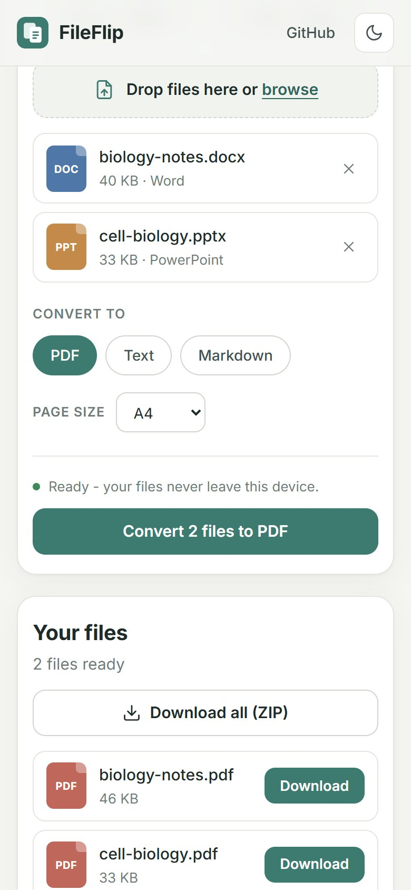

# 📄 FileFlip

**Convert your files, simply.** PDF to Word, Word to PDF, slides to study notes, Excel to
CSV, Markdown to PDF, images to PDF, plus PDF merge / split / rotate / compress.

Built with Python for students: no sign-up, no ads, no watermarks, and your files stay private.

### 🔗 Live: **[insofury.github.io/fileflip](https://insofury.github.io/fileflip/)**

The live site runs **100% in your browser**: the Python code runs on
[Pyodide](https://pyodide.org) (Python compiled to WebAssembly), so your files are never
uploaded anywhere.

[](https://github.com/Insofury/fileflip/actions/workflows/ci.yml)
[](https://github.com/Insofury/fileflip/actions/workflows/pages.yml)



<table>
  <tr>
    <td width="66%"></td>
    <td></td>
  </tr>
</table>

## What it converts

| From | To |
|---|---|
| **PDF** | Word (.docx), Text, Markdown, HTML |
| **Word** (.docx) | PDF, Text, Markdown, HTML |
| **PowerPoint** (.pptx) | PDF notes, Word notes, Text, Markdown |
| **Excel** (.xlsx) | CSV (one per sheet), PDF, Word, HTML |
| **CSV** | Excel, PDF, Word, HTML |
| **Markdown** (.md) | PDF, Word, HTML, Text |
| **HTML** | PDF, Word, Markdown, Text |
| **Text** (.txt) | PDF, Word, HTML |
| **Images** (JPG, PNG, WebP, GIF, BMP, TIFF) | PDF (one page each, or all in one PDF), Word, JPG, PNG, WebP |

**PDF tools:** merge PDFs (in the order you choose), split (every page or ranges like
`1-3, 5`), rotate (all or chosen pages), compress (light / balanced / strong).

### What's kept

- **Headings, bold, italic, underline and links**
- **Bullet and numbered lists**, including nested levels
- **Tables**, also rebuilt from PDFs where the cells line up in rows and columns
- **Pictures**, at their place in the document
- **Page breaks**, plus page numbers in generated PDFs
- **Accented letters, Greek, Cyrillic and symbols** like € → ✓, via the bundled DejaVu fonts

**PDF → Word** works on PDFs that contain text, which is most of them. Scanned pages are
only pictures, so they need OCR first; FileFlip keeps the pictures and tells you.

### Built for real-world files

**PDFs**
- PDFs made with **Canva** and other design tools (text inside "form" objects).
- Bullets drawn as small shapes, letter-spaced titles ("R E S U M E").
- Superscript ordinals (10<sup>th</sup>), side-by-side columns, and bullet points split
  across text boxes.

**Office files**
- Word **content controls, text boxes, equations and tracked changes**.
- Macro-enabled and template files: `.docm`, `.dotx`, `.pptm`, `.ppsx`, `.potx`, `.xlsm`,
  `.xltx`.

**Images**
- Phone photos come out **upright**.
- **Multi-page TIFF** scans.
- CMYK and 16-bit images.

**Odd text**
- Control characters, very long cells, wide tables (they get a landscape page), and
  formula-like text in spreadsheets (kept as text).

**When the main reader can't cope:**
- Every reader has a **fallback**: pypdf for PDFs, raw XML for Word and PowerPoint, and a
  second mode for Excel.
- Writers fall back to plain text for anything they can't format.
- So you get a file, plus a note about anything that was simplified, instead of an error.

**Never-crash tests:** the tests feed damaged versions of every file type to every output
and check that each one gives either a result or a clear message.

## Two ways to run it

| | Browser version (GitHub Pages) | Server version (FastAPI) |
|---|---|---|
| Where | [insofury.github.io/fileflip](https://insofury.github.io/fileflip/) | `python run.py`, Docker, Render… |
| How | A Web Worker runs the Python code with Pyodide | The browser uploads files to the API |
| Privacy | Files never leave the device | Converted in memory, never stored |
| First use | Downloads Python once (then cached) | Instant |

Both use **the same Python code**. The UI picks the engine automatically: the Pages build
includes a `browser-mode.json` file, the server doesn't. In the browser each library is
downloaded only when a conversion needs it (for example the PDF reader only when you
convert a PDF).

## Quick start (server version)

Requires **Python 3.11+**.

```bash
git clone https://github.com/Insofury/fileflip.git
cd fileflip
python -m venv .venv
```

```bash
# Windows
.venv\Scripts\activate
# macOS / Linux
source .venv/bin/activate
```

```bash
pip install -r requirements.txt
python run.py
```

Open **http://localhost:8000**. Settings are in [`.env.example`](.env.example).

## API

Interactive docs at **`/api/docs`**.

```bash
# PDF -> Word
curl -F "file=@notes.pdf" -F "target=docx" -o notes.docx http://localhost:8000/api/convert

# merge PDFs
curl -F "files=@a.pdf" -F "files=@b.pdf" -o merged.pdf http://localhost:8000/api/tools/merge

# split pages 1-3 and 4-6
curl -F "files=@book.pdf" -F 'options={"mode":"ranges","ranges":"1-3, 4-6"}' -o parts.zip http://localhost:8000/api/tools/split
```

| Method | Path | Description |
|---|---|---|
| `POST` | `/api/convert` | `file` + `target` (`pdf`, `docx`, `xlsx`, `csv`, `txt`, `md`, `html`, `jpg`, `png`, `webp`) + optional `page_size` (`A4`/`Letter`) |
| `POST` | `/api/tools/{tool}` | `merge`, `split` (`mode`, `ranges`), `rotate` (`angle`, `pages`), `compress` (`level`), `images-to-pdf`; `files` + `options` JSON |
| `GET` | `/api/formats` | What converts to what, and the limits |
| `GET` | `/api/health` | Health check |

Results with several files (a CSV per sheet, split pages) come back as a ZIP. Details such
as the file name, size and notes are in the `X-FileFlip-Info` response header.

## Deploy (free)

**GitHub Pages (browser version):** every push to `main` runs
[`.github/workflows/pages.yml`](.github/workflows/pages.yml), which builds the static site
with `scripts/build_pages.py` and publishes it. To preview it locally:

```bash
python scripts/build_pages.py
python -m http.server -d _site 8070
```

**Docker / Render (server version):** use the [`Dockerfile`](Dockerfile) or
[`render.yaml`](render.yaml).

## Project structure

```
fileflip/
├── app/
│   ├── model.py        the document model every conversion goes through
│   ├── formats.py      file detection, what converts to what
│   ├── readers/        pdf, word, slides, sheets (xlsx/csv), markup (txt/md/html), images
│   ├── writers/        pdf, word, sheets (xlsx/csv), markup (txt/md/html)
│   ├── pdftools.py     merge, split, rotate, compress, images -> PDF
│   ├── convert.py      the conversion use case (shared by API and browser)
│   ├── browser.py      entry point for the Pyodide / GitHub Pages build
│   ├── compat.py       small shims so fpdf2 also runs in the browser
│   ├── fonts/          DejaVu fonts for Unicode PDFs
│   ├── main.py         FastAPI routes + static site
│   ├── security.py     rate limiting, security headers, upload limits
│   └── config.py       settings from environment variables
├── static/             HTML, CSS and vanilla JS (engine.js, worker.js, zip.js)
├── scripts/build_pages.py   builds the GitHub Pages site into _site/
├── tests/              111 pytest tests (incl. damaged-file "never crash" tests)
└── docs/PROJECT_NOTES.md    full module-by-module guide
```

📘 See **[docs/PROJECT_NOTES.md](docs/PROJECT_NOTES.md)** for how everything works.

## Tests

```bash
pip install -r requirements-dev.txt
pytest -q
```

## Credits

[pdfminer.six](https://github.com/pdfminer/pdfminer.six), [pypdf](https://github.com/py-pdf/pypdf),
[python-docx](https://github.com/python-openxml/python-docx),
[python-pptx](https://github.com/scanny/python-pptx), [openpyxl](https://openpyxl.readthedocs.io),
[fpdf2](https://github.com/py-pdf/fpdf2), [Python-Markdown](https://python-markdown.github.io),
[Pillow](https://python-pillow.org), [Pyodide](https://pyodide.org), [FastAPI](https://fastapi.tiangolo.com)
and the [DejaVu fonts](https://dejavu-fonts.github.io) (see `app/fonts/LICENSE-DejaVu.txt`).

## License

MIT - see [LICENSE](LICENSE).
