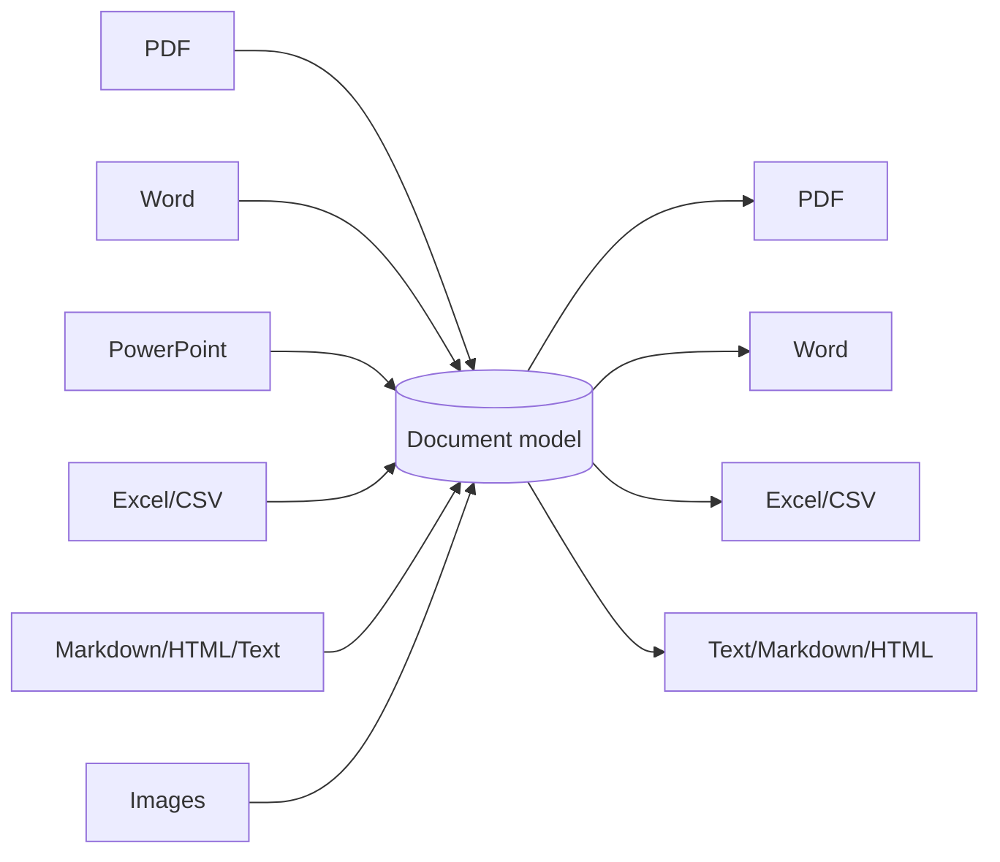

# FileFlip - Project Notes & Code Guide

A guide to how FileFlip works: what each module contains, how the pieces fit together, and
why the main decisions were made. Read it once from top to bottom, then use it as a
reference.

---

## 1. Summary

**FileFlip** converts documents between formats, with students in mind:

| From | To |
|---|---|
| PDF | Word, Text, Markdown, HTML |
| Word (.docx) | PDF, Text, Markdown, HTML |
| PowerPoint (.pptx) | PDF notes, Word notes, Text, Markdown |
| Excel (.xlsx) | CSV, PDF, Word, HTML |
| CSV | Excel, PDF, Word, HTML |
| Markdown / HTML / Text | PDF, Word, HTML / Markdown / Text |
| Images | PDF (one or many), Word, JPG, PNG, WebP |

**PDF tools:** merge, split, rotate and compress.

**Tech stack:**
- **Python 3.11+**
- **Reading files:** pdfminer.six (PDF text and layout), pypdf (PDF images and tools),
  python-docx, python-pptx, openpyxl, Python-Markdown and Pillow
- **Writing PDFs:** fpdf2
- **Server:** FastAPI and Uvicorn
- **Browser:** vanilla HTML, CSS and JavaScript, with Pyodide for the GitHub Pages version
- **Quality:** pytest and GitHub Actions

### Two versions, one codebase

| | Server version | Browser version (GitHub Pages) |
|---|---|---|
| Runs | FastAPI on any Python host | Static files on GitHub Pages |
| Conversion code | `app/convert.py` in CPython | the same file in Pyodide (WebAssembly) |
| Files | uploaded, converted in memory, discarded | never leave the device |
| Libraries | installed with pip | downloaded by the browser on first use, then cached |

---

## 2. The big idea: one document model

Converting every format to every other format directly would need dozens of converters
(9 inputs × 10 outputs). Instead, every input is first read into one simple model, and
every output is written from that model:



So adding a new input format means writing **one reader**, and it immediately converts to
every output.

### `app/model.py`

A `Document` is a title, a list of **blocks** and a list of **notes** for the user:

| Block | Fields |
|---|---|
| `Paragraph` | `runs`, `style` (normal, title, h1, h2, h3, quote, code), `align` |
| `ListItem` | `runs`, `ordered`, `level` (0-3) |
| `Table` | `rows` (list of lists of text), `header`, `name` (e.g. the sheet name) |
| `Image` | `data` (PNG or JPEG), `mime`, `width`, `height` |
| `PageBreak` | - |

A **`Run`** is a piece of text with one formatting: `bold`, `italic`, `underline`, `code`,
`link`.

Helpers:
- `merge_runs` joins neighbours that have the same format;
- `strip_runs` trims a paragraph;
- `normalize_image` turns any image Pillow can read into PNG (if it has transparency) or
  JPEG, and limits its size.

**`ConvertError`** carries a message written for users and an HTTP status for the API.

---

## 3. Folder structure

```
fileflip/
├── app/
│   ├── __init__.py        version
│   ├── model.py           the document model
│   ├── formats.py         detection, targets, packages per step, formats_info()
│   ├── readers/
│   │   ├── __init__.py    read(kind, data) - imports each reader only when needed
│   │   ├── pdf.py         PDF -> Document (pdfminer.six + pypdf)
│   │   ├── word.py        .docx -> Document (python-docx)
│   │   ├── slides.py      .pptx -> Document (python-pptx)
│   │   ├── sheets.py      .xlsx / .csv -> Document (openpyxl, csv)
│   │   ├── markup.py      .txt / .md / .html -> Document (html.parser, Markdown)
│   │   └── images.py      images -> Document
│   ├── writers/
│   │   ├── __init__.py    write(target, doc)
│   │   ├── pdf.py         Document -> PDF (fpdf2)
│   │   ├── word.py        Document -> .docx (python-docx)
│   │   ├── sheets.py      Document -> .xlsx / .csv
│   │   └── markup.py      Document -> .txt / .md / .html
│   ├── pdftools.py        merge, split, rotate, compress, images -> PDF
│   ├── convert.py         convert() and run_tool() - the shared use case
│   ├── browser.py         Pyodide entry points
│   ├── compat.py          fpdf2 import shim for the browser
│   ├── fonts/             DejaVu fonts + licence; supported_chars()
│   ├── config.py          Settings from environment variables
│   ├── security.py        rate limiter, upload limit, security headers
│   └── main.py            FastAPI app
├── static/                index.html, css/styles.css, js/{app,engine,worker,zip,theme}.js
├── scripts/build_pages.py GitHub Pages build
├── tests/                 111 tests (samples.py builds every file type in memory)
└── docs/                  these notes + screenshots
```

---

## 4. Readers (file -> Document)

### 4.1 `formats.detect` - what is this file?

The content wins over the file name:
- `%PDF-` at the start means a PDF;
- a ZIP that contains `word/document.xml`, `ppt/presentation.xml` or `xl/workbook.xml`
  is Word, PowerPoint or Excel (so a mis-named `.pdf` that is really a `.docx` still
  works);
- images are recognised by their signature bytes;
- CSV, Markdown, HTML and text go by extension.

Old binary formats (`.doc`, `.ppt`, `.xls`) and HEIC get a friendly "save it as … first"
message.

### 4.2 `readers/pdf.py` - the hardest one

A PDF has no paragraphs or headings: only characters placed at positions on a page. The
reader rebuilds the structure the way a person reads it:

1. **Layout:** `pdfminer.six` groups characters into lines and text boxes
   (`LAParams(line_margin=0.6, boxes_flow=0.5, all_texts=True)`).
   - **Figures:** Canva, design tools and some print drivers wrap whole pages (or blocks)
     in *form XObjects*. pdfminer reports them as figures, and `all_texts=True` lays out
     the text inside them too.
   - `_collect` walks into figures, keeping each figure's boxes as a group.
   - `_merge_groups` starts from the biggest group and inserts every other group as a
     whole where its top edge falls, so a summary or sidebar in its own figure lands in
     the right place.
   - *(This was the bug behind "no text" on a Canva CV: every word was inside a figure.)*
2. **Body size:** the most common character size across the document is the body text.
3. **Line clean-up:**
   - Letter-spaced titles become words: `A S H I S H   C H A H A R` → `ASHISH CHAHAR`.
   - Doubled spaces from justified text are collapsed.
   - Unreadable `(cid:123)` glyphs are removed, with a note.
4. **Superscripts:** ordinals that pdfminer splits off ("10" + small raised "th") are put
   back after their number:
   - when they sit on the same line (`_line`);
   - when they're in a line of their own (`_superscripts`).
5. **Segments:** each box is split into blocks wherever:
   - the font size changes;
   - a bullet starts: a bullet character, or a **small drawn dot or square** just left of
     the line (many designed CVs draw bullets as shapes);
   - a short all-bold line is followed by normal text (a heading on top of its paragraph);
   - a line ends a sentence well short of the box width (end of a paragraph);
   - there's a vertical gap.
6. **Headings:**
   - text ≥ 1.6× the body size is `h1`, ≥ 1.3× is `h2`;
   - short, slightly larger or all-bold lines without a full stop are `h3`.
7. **Formatting:** bold and italic come from font names (`Arial-BoldMT`, `Times-Italic`),
   kept per run.
8. **Lists:**
   - **Nesting:** within each run of consecutive items, an item indented further than the
     previous one goes one level deeper (`_set_list_levels`).
   - **Continuations:** a plain line right under a bullet point, starting where its text
     starts, is joined to it.
9. **Joining lines:** lines are joined with spaces, and end-of-line hyphenation is undone
   (`exam-` + `ple` = `example`).
10. **Page numbers:** short number-only text ("3", "Page 3 of 9") in the top or bottom 8%
    of a page is dropped.
11. **Tables:** `_find_tables` looks for short text boxes that line up into at least
    2 rows × 2 columns:
    - the rows are boxes whose tops are at the same height;
    - cells that overlap within a row are merged;
    - neighbouring rows must have cells that **overlap horizontally**, so indented
      (bulleted) cells still line up, and must be close together.
12. **Pictures:**
    - pypdf extracts each image (it handles JPEG, Flate, masks and CMYK);
    - pdfminer knows each image's name and position;
    - each picture is inserted before the first text box that starts below its top edge.
13. **Fallback:** if pdfminer fails, or finds no text, pypdf's own text extraction is
    tried. The result has paragraphs and lists, plus a note that headings and tables may
    be plain text.
14. **Scans and outlines:**
    - A PDF without text keeps its pictures and gets a note suggesting OCR.
    - With no text and no pictures, the message explains that the text was probably saved
      as shapes.
15. **Errors:** password-protected files produce a clear message. Only the first 400 pages
    are converted.

### 4.3 `readers/word.py`

Walks the body XML in order, so paragraphs and tables stay interleaved:
- **Style:** Title → `title`, Heading 1 → `h1`, Heading 2 → `h2`, Heading 3+ → `h3`,
  Quote → `quote`.
- **Lists:** read from the paragraph's numbering properties. The numbering definitions
  (`w:abstractNum`/`w:lvl`/`w:numFmt`) say whether it's bullets or numbers and which level.
  Falls back to "List Bullet 2"-style names.
- **Runs:** bold / italic come from the run or its paragraph style; underline; a monospace
  font means `code`; hyperlinks keep their URL.
- **Tables:** merged cells, which python-docx repeats, are kept only once.
- **Pictures:** found through `a:blip/@r:embed` relationships. EMF/WMF drawings Pillow
  can't read are counted in a note.
- **Page breaks:** `<w:br w:type="page">`.
- **Text python-docx's simple API skips** (`_runs`, `_Reader.walk`):
  - content controls (`w:sdt`, both whole blocks and inline);
  - text boxes (`w:txbxContent`, skipping the duplicate `mc:Fallback` copy kept for old
    Word versions);
  - tracked insertions (`w:ins`), with tracked deletions left out;
  - smart tags, simple fields, and equations (`m:oMath`, as italic text).
- **Robustness:**
  - A paragraph or table python-docx can't handle falls back to its raw text.
  - If python-docx can't open the file at all (`.docm`, `.dotx` or odd XML),
    `_read_with_xml` reads the main part with the standard library's `ElementTree`. It
    finds that part through `[Content_Types].xml` and keeps headings, lists, tables and
    page breaks.

PowerPoint works the same way:
- every shape is converted on its own, so one chart or diagram that fails can't stop
  the rest;
- if python-pptx refuses the file, the slide text is read straight from the XML, in
  slide order.

Excel:
- read-only mode first (fast);
- then normal mode if that finds nothing, because some files misreport their size.

### 4.4 `readers/slides.py`

Each slide becomes study notes:
- a heading "Slide 3: Title";
- shapes in reading order (top to bottom, then left to right): text as bullet points with
  their indent level, tables, pictures, and grouped shapes;
- the speaker notes, as a quote.

Subtitle and plain text boxes become paragraphs rather than bullets. Slides are separated
by page breaks, so the PDF reads like a handout.

### 4.5 `readers/sheets.py`

- **Excel:** openpyxl in `read_only` / `data_only` mode, so it reads formula results, not
  formulas.
  - Each non-empty sheet becomes a table, with a heading if there are several sheets.
  - Values are formatted for people: `91.0` → `91`, dates as ISO, booleans as TRUE/FALSE.
  - Empty trailing rows and columns are trimmed. At most 20,000 rows and 200 columns.
- **CSV:** the delimiter (`,` `;` tab `|`) is detected with `csv.Sniffer`. A BOM and
  Windows-1252 text are handled.

### 4.6 `readers/markup.py`

- **Text:** blank lines separate paragraphs; lines starting with `-` or `1.` become lists;
  a form feed is a page break.
- **Markdown:**
  - Python-Markdown (with tables, fenced code and sane lists) produces HTML, which the
    HTML reader turns into blocks.
  - Two-space nested lists are widened to four first, because Python-Markdown needs 4
    spaces and most people use 2.
- **HTML:** a small `HTMLParser` subclass with these rules:
  - **Tags:** headings, paragraphs and divs, `b`/`i`/`u`/`code`/`a`, nested `ul`/`ol`,
    `table`, `pre`, `blockquote`, alignment, and the `<title>`.
  - **Skipped:** scripts and styles.
  - **Pictures:** only images embedded as `data:` URIs are used; remote ones are counted
    in a note.

---

## 5. Writers (Document -> file)

### 5.1 `writers/pdf.py` (fpdf2)

**Page and fonts:**
- A4 or Letter pages with 20 mm margins, and page numbers in the footer.
- The calm colours match the website.
- The bundled **DejaVu** fonts (regular / bold / italic / bold italic / mono) are
  registered, because the standard PDF fonts only cover Latin-1.

**Blocks:**
- **Headings:** bigger, bold, with the title and h1 in the accent colour. They start a new
  page if they would sit alone at the bottom.
- **Paragraphs:**
  - Paragraphs with mixed formatting are written run by run with `pdf.write()` (bold,
    italic, underline, clickable links).
  - Paragraphs with one formatting use `multi_cell`, which supports centred, right and
    justified alignment.
- **Lists:** bullets • and ◦ alternate by level; numbers restart properly.
- **Quotes:** italic with an accent bar. **Code:** monospace on a light background.
- **Tables:** fpdf2's `table()` with a soft header row. The font gets smaller when there
  are many columns.
- **Pictures:** scaled to fit the width (and the page height), centred, moved to the next
  page if needed.
- **Missing characters:** `fonts.supported_chars()` (read with fontTools) checks the
  text. Characters the font can't draw (emoji, Hindi, Chinese) produce a note instead of
  silent blanks.

### 5.2 `writers/word.py` (python-docx)

- A4/Letter page, 22 mm margins, Calibri 11.
- Real Word styles: Title, Heading 1-3, Quote, List Bullet/Number (+ levels 2-3), Table
  Grid with a bold header.
- **Real clickable hyperlinks:** python-docx has no API for them, so the `<w:hyperlink>`
  XML is built with a relationship ID.
- Pictures at their natural size, capped to the page width.

### 5.3 `writers/sheets.py`

- **Excel:**
  - One sheet per table. Names are cleaned to Excel's rules (no `[]:*?/\`, at most 31
    characters, unique).
  - Bold header with a soft fill, frozen header row, and column widths fitted to the
    content.
  - Numbers become real numbers ("1,234.5" → 1234.5), so formulas work.
  - Values with leading zeros, such as phone numbers, roll numbers and IDs, stay text.
- **CSV:** one file per table, UTF-8 with a BOM so Excel shows accented letters correctly.

### 5.4 `writers/markup.py`

- **Text:**
  - Blank lines between paragraphs; list items kept together, with indents and numbers.
  - Tables become tab-separated values.
  - Pictures are counted in a note.
- **Markdown:**
  - `#` headings, `**bold**`, `*italic*`, `` `code` ``, `[links](url)`.
  - Nested `-` / `1.` lists, pipe tables and `>` quotes.
  - Special characters are escaped.
- **HTML:** a complete, standalone page with gentle built-in CSS. Pictures are embedded
  as `data:` URIs, so the file works offline and can be emailed.

---

## 6. PDF tools (`app/pdftools.py`)

- **`parse_ranges("1-3, 5, 8-", count)`** → groups of page indexes.
  - `8-` means "to the end". Reverse ranges work too.
  - Out-of-range or garbled input gets a clear message.
- **merge:** pages of every PDF, in the order given.
- **split:** every page, or one file per range. Names look like `book-pages-1-3.pdf`.
- **rotate:** 90/180/270°, all pages or a range.
- **compress:**
  - Pictures (skipping small or transparent ones) are recompressed as JPEG and downscaled
    by level:
    | Level | Longest side | JPEG quality |
    |---|---|---|
    | Light | 2400 px | 85 |
    | Balanced | 1800 px | 70 |
    | Strong | 1200 px | 50 |
  - Page content streams are compressed and duplicate or unused objects removed.
  - If the result is not smaller, the original is kept and a note says so.
- **images_to_pdf:** each picture on its own page (landscape for wide pictures), centred
  with 10 mm margins.

Password-protected PDFs (unless the password is empty) get a clear message.

---

## 7. The shared use case (`app/convert.py`)

- **`convert(data, filename, target, page_size)`:** detect → check the target is allowed →
  read → write → `Output(filename, data, mime, notes)`.
  - Image → image conversions skip the model and use Pillow directly: EXIF rotation is
    applied, and transparency is flattened onto white for JPG.
  - When a writer produces several files (a CSV per sheet), they are zipped.
- **`run_tool(tool, files, options)`:** checks every file is the right kind, runs the
  tool, and zips several outputs.
- **`stem()`:** keeps the original name, drops paths and characters that are invalid in
  file names.

---

## 8. Server (`app/main.py`, `security.py`, `config.py`)

| Route | Purpose |
|---|---|
| `GET /api/formats` | kinds, extensions, targets, output labels, tools, limits - the UI is built from this |
| `POST /api/convert` | multipart `file`, `target`, `page_size` → the file; details in `X-FileFlip-Info` |
| `POST /api/tools/{tool}` | multipart `files[]` + `options` JSON |

**Safety:**
- Per-IP rate limit (60/minute).
- Upload size limit checked from `Content-Length` before reading, and again while reading
  each file.
- At most 20 files per request.
- Conversions run in worker threads, with a semaphore limiting how many run at once.
- Strict Content-Security-Policy and other security headers.
- File names in `Content-Disposition` use RFC 5987, so non-English names download
  correctly.

---

## 9. Browser version

### `scripts/build_pages.py`

1. Copies `static/` and `index.html`. All paths are relative, so the site works under
   `/fileflip/`.
2. Copies every module of the `app` package except the server-only `main.py`,
   `config.py` and `security.py`, plus the fonts.
3. Writes `browser-mode.json`, which contains:
   - the Pyodide version;
   - **pinned package versions tested in Pyodide 0.26.4** (pypdf 7.0.0, pdfminer.six
     20260107, python-docx 1.2.0, python-pptx 1.0.2, openpyxl 3.1.5, fpdf2 2.9.0,
     Markdown 3.11.3);
   - which packages each reader, writer and tool needs;
   - the module list and fonts;
   - the formats info.

The build uses only the standard library, so the GitHub Actions job needs no `pip install`.

### `static/js/worker.js` (a Web Worker, so the page never freezes)

1. Loads Pyodide with `micropip` and Pillow, then fetches the FileFlip modules into
   Pyodide's in-memory file system.
2. For each conversion:
   - `browser.inspect()` detects the file and lists the packages that conversion needs;
   - missing packages are installed with micropip (pinned versions);
   - for PDF output, the fonts are fetched;
   - finally `browser.convert_file()` runs.
3. `prepare` messages from the page start downloading libraries as soon as a format is
   chosen, before Convert is clicked.

### `app/compat.py`

Pyodide has no `ssl` module, so `urllib.request.HTTPSHandler` and
`http.client.HTTPSConnection` don't exist. fpdf2 subclasses both when it is imported (to
fetch images from URLs, which FileFlip never does). Placeholder classes let the import
work.

### `static/js/app.js`

- Two modes: **Convert files** and **PDF tools**.
- **Popular-conversion shortcuts** (PDF → Word, …) open the file picker filtered to the
  right type.
- Files are recognised by extension, using the formats info.
- The **format chips** show only the outputs that every selected file supports. Mixed
  batches get a hint if they have nothing in common.
- Options appear only when relevant: page size for PDF/Word, "combine into one PDF" for
  several images.
- **PDF tools:**
  - Tool cards with their own options.
  - Merge order is set with up/down buttons.
  - Validation: merge needs at least 2 PDFs; split takes one at a time.
- **Results:** one row per file with its size, notes and a Download button, plus
  **Download all (ZIP)** using the dependency-free `zip.js`.

**Design:** calm on purpose.
- Soft "paper" background with white cards and generous spacing.
- One muted sage-green accent.
- Desaturated colours per file type.
- Gentle transitions, and support for reduced motion.
- A matching dark theme.

---

## 10. Testing

```bash
pip install -r requirements-dev.txt
pytest -q          # 111 tests
```

| File | Covers |
|---|---|
| `tests/samples.py` | builds a Word file, slides, a workbook, a PDF, Markdown, HTML and images in memory |
| `test_readers.py` | detection (incl. wrong extensions, legacy formats), each reader's structure: headings, runs, nested lists, tables, pictures, notes, page breaks, PDF table/heading/list rebuilding, scans, damaged files |
| `test_convert.py` | **every input × every target**, round trips (Word → PDF → Word keeps text, table and picture), Excel ⇄ CSV with numbers vs IDs, text/Markdown output, missing-character notes, image conversions, file names, all PDF tools and their error messages |
| `test_api_and_pages.py` | API routes, headers, Unicode file names, limits, rate limiting, CSP, the Pyodide entry points, the Pages build, and a guard that browser modules never import server-only libraries |
| `test_robustness.py` | Canva-style PDFs (text in figures), drawn bullets, letter spacing, superscripts, pypdf fallback, PDFs with no text, Word content controls / text boxes / equations / tracked changes, .docm and .pptm, rotated photos, multi-page TIFF, CMYK and 16-bit images, control characters, formula-like cells, wide and huge tables, and damaged versions of every file type |

---

## 11. Robustness: "never show a crash"

Every layer has a safety net, so users get a file (with notes about anything simplified)
or a clear message, never a stack trace:

| Layer | Safety net |
|---|---|
| Readers | Fallback readers: pypdf for PDF, raw XML for Word/PowerPoint, a second mode for Excel. Per-shape and per-paragraph `try` blocks. |
| Model | `sanitize()` cleans every string once after reading. It drops characters Word/Excel/XML can't store and invisible zero-width marks, and turns `\v`/`\f` into line breaks. |
| Images | `open_image_frames()` applies EXIF rotation, reads every page of a TIFF, and refuses images over 120 MP instead of running out of memory. `_to_8bit()` handles 16-bit. CMYK and palette images are converted. |
| PDF writer | Tables wider than 8 columns get a landscape page; wider than 30 become text lines. Long cells are trimmed. Any block that fails is written as plain text. |
| Word writer | Tables are built row by row (fast for big sheets); any block that fails becomes plain text. |
| Excel writer | Cells are capped at Excel's 32,767 characters. Text that looks like a formula (`=1+1`) is stored as text. |
| `convert()` / `run_tool()` | Unexpected exceptions become a `ConvertError` naming the problem; `MemoryError` gets a "too big" message. |
| API | A last-resort exception handler logs the details and returns a calm JSON message. |

`tests/test_robustness.py` covers:
- the real-world cases above, including the Canva-style CV layout rebuilt synthetically:
  form XObjects, drawn bullets, letter spacing, superscripts;
- **damaged versions of every sample** (cut short, zero-filled, scrambled) converted to
  **every target**: each must either succeed or raise a `ConvertError`.

## 12. Limitations and ideas

- **Scanned PDFs** need OCR (e.g. Tesseract) to get editable text.
- **PDF → Word** rebuilds structure, not exact layout: multi-column magazines and complex
  tables may need tidying.
- **Word → PDF** follows the document's structure, not Word's exact typesetting. For a
  pixel-perfect copy, a LibreOffice backend could be added to the server version.
- **Hindi, Chinese and emoji** in PDFs need extra fonts (and text shaping for scripts like
  Devanagari).
- **Ideas:**
  - PDF → images using pdf.js in the browser;
  - add page numbers or a watermark to existing PDFs;
  - OpenDocument (.odt) input.
